# Diagrama de Estados en Itemis Create (`task_display`)

El modelo consta de 2 estados (`ST_DSP_IDLE` y `ST_DSP_UPDATE`). Desde `ST_DSP_UPDATE` salen 3 transiciones disparadas por `tick` evaluadas según su **orden de prioridad (1, 2 y 3)**:

```mermaid
stateDiagram-v2
    direction LR
    [*] --> ST_DSP_IDLE

    ST_DSP_IDLE --> ST_DSP_UPDATE : EV_DSP_UPDATE

    ST_DSP_UPDATE --> ST_DSP_IDLE : 1: tick [row >= ROWS] / displayCharPositionWrite(0, 0); row = 0; column = 0; flag = false
    ST_DSP_UPDATE --> ST_DSP_UPDATE : 2: tick [column < COLUMNS] / displayDataWrite(character); column++
    ST_DSP_UPDATE --> ST_DSP_UPDATE : 3: tick / row++; column = 0; displayCharPositionWrite(0, row)
```



---

## Transiciones salientes de `ST_DSP_UPDATE` (por orden de prioridad)

Al seleccionar el bloque `ST_DSP_UPDATE` en Itemis Create, en la pestaña **Properties $\rightarrow$ Outgoing Transitions** ordenalas así:

1. **Prioridad 1 (`ST_DSP_UPDATE` $\rightarrow$ `ST_DSP_IDLE`) — Fin de las filas, devuelve cursores de display y DDRAM a `(0,0)`:**
   ```text
   tick [row >= ROWS] / displayCharPositionWrite(0, 0); row = 0; column = 0; flag = false
   ```
   *(Con literales: `tick [row > 1] / displayCharPositionWrite(0, 0); row = 0; column = 0; flag = false`)*

2. **Prioridad 2 (Lazo 1: `ST_DSP_UPDATE` $\rightarrow$ `ST_DSP_UPDATE`) — Recorre DDRAM e imprime 1 carácter:**
   ```text
   tick [column < COLUMNS] / displayDataWrite(character); column++
   ```
   *(Con literales: `tick [column < 16] / displayDataWrite(character); column++`)*

3. **Prioridad 3 (Lazo 2: `ST_DSP_UPDATE` $\rightarrow$ `ST_DSP_UPDATE`) — `else`: avanza de fila y posiciona el cursor en la nueva fila:**
   ```text
   tick / row++; column = 0; displayCharPositionWrite(0, row)
   ```

---

## Bloque de Definiciones (`interface:`) para Itemis Create

```text
interface:
    in event tick
    in event EV_DSP_UPDATE

    const ROWS: integer = 2
    const COLUMNS: integer = 16

    var row: integer = 0
    var column: integer = 0
    var character: integer = 0
    var flag: boolean = false

    operation displayDataWrite(data: integer): void
    operation displayCharPositionWrite(x: integer, y: integer): void
```
